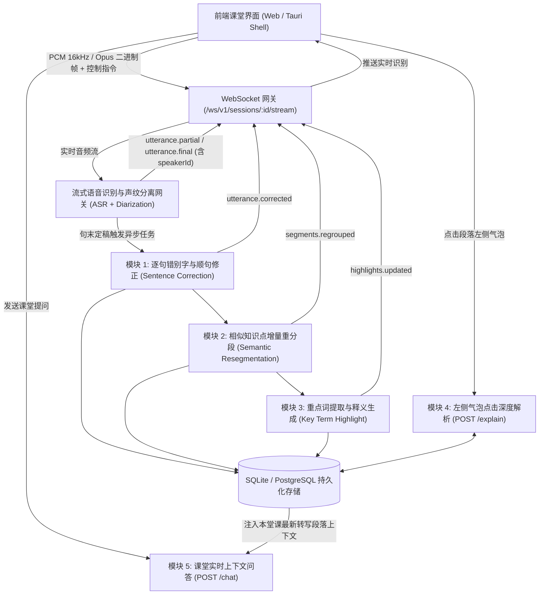

# 知聆课堂（AI 听课工作台）后端开发与接口规范手册

本文档面向后端开发工程师，完整规定了与当前前端工程（`src/services/api.ts`、`src/services/classroomSocket.ts`、`src/types/domain.ts`）零改造对接的服务端架构、数据库表结构、RESTful 接口契约、实时 WebSocket 流协议，以及 OpenAI / Anthropic / Google Gemini 三大原生协议与多语音转写供应商的适配层实现规范。

---

## 1. 前后端联调零改造接入方式

前端已将所有 HTTP 与 WebSocket 通信完全解耦在 `src/services/` 层。后端服务就绪后，只需在项目根目录创建 `.env.local` 并设置：

```ini
VITE_USE_MOCK=false
VITE_API_BASE_URL=http://127.0.0.1:8000/api/v1
VITE_WS_BASE_URL=ws://127.0.0.1:8000/ws/v1
```

无需修改任何前端组件与状态管理代码即可完成全链路对接。

---

## 2. 后端整体架构与实时处理流水线

推荐使用 **Python 3.11+（FastAPI + AsyncIO + SQLAlchemy + SQLite/PostgreSQL）** 或 **Rust（Axum + Tokio + SQLx）** 实现本地/云端一体后端守护服务。



### 核心异步流水线编排原则
1. **低延迟转写优先**：ASR 返回临时识别结果时立即向前端推送 `utterance.partial`；VAD 判定单句结束返回定稿与讲话人标签（`speakerId`）时，先写入数据库并立即推送 `utterance.final`。
2. **句级修正（可开关）**：若 `settings.featureRouting.sentenceCorrection.enabled === true`，异步调用该功能绑定的大模型，结合学科上下文修正同音错别字与中英专业术语，完成后更新 `refined_text` 并推送 `utterance.corrected`。
3. **增量知识点分段（可开关）**：每新增 1–2 句定稿语句（或检测到语义转折），调用 `resegmentation` 绑定的模型评估“当前句应归入最后一个 `KnowledgeSegment`，还是开启新的 `KnowledgeSegment`”，更新段落标题 `topicTitle` 后推送 `segments.regrouped`。
4. **重点词荧光笔标注（可开关）**：在段落内容更新后，调用 `keyTermHighlight` 绑定的模型提取该段核心专业词汇及 30–60 字简明语境释义，写入 `segment_highlights` 并推送 `highlights.updated`。
5. **气泡深度解析（按需懒加载 + 缓存）**：用户点击某段左侧气泡图标时，前端请求 `POST /sessions/:sessionId/segments/:segmentId/explain`。若数据库已有缓存直接返回；否则调用 `bubbleExplanation` 模型生成结构化标题、要点列表与详尽阐释并落库缓存。

---

## 3. 数据库表结构设计（SQLite / PostgreSQL 通用 DDL）

```sql
-- 1. 文件夹表
CREATE TABLE folders (
    id           VARCHAR(64) PRIMARY KEY,
    name         VARCHAR(255) NOT NULL,
    parent_id    VARCHAR(64) NULL REFERENCES folders(id) ON DELETE SET NULL,
    created_at   TIMESTAMP NOT NULL DEFAULT CURRENT_TIMESTAMP,
    updated_at   TIMESTAMP NOT NULL DEFAULT CURRENT_TIMESTAMP
);

-- 2. 课堂会话表
CREATE TABLE class_sessions (
    id               VARCHAR(64) PRIMARY KEY,
    folder_id        VARCHAR(64) NULL REFERENCES folders(id) ON DELETE SET NULL,
    title            VARCHAR(255) NOT NULL,
    status           VARCHAR(20) NOT NULL DEFAULT 'idle', -- idle | recording | paused
    duration_seconds INTEGER NOT NULL DEFAULT 0,
    audio_file_path   TEXT NULL,
    created_at       TIMESTAMP NOT NULL DEFAULT CURRENT_TIMESTAMP,
    updated_at       TIMESTAMP NOT NULL DEFAULT CURRENT_TIMESTAMP
);

-- 3. 课堂讲话人档案表（声纹映射）
CREATE TABLE speakers (
    id                  VARCHAR(64) PRIMARY KEY,
    session_id          VARCHAR(64) NOT NULL REFERENCES class_sessions(id) ON DELETE CASCADE,
    diarization_channel VARCHAR(64) NOT NULL, -- 对应底层 ASR 返回的 speaker_0 / role_1 等原始标识
    label               VARCHAR(100) NOT NULL, -- 前端展示名称，如 "主讲人 1"、"周教授"
    voice_embedding     BLOB NULL
);

-- 4. 知识点分段表（AI 自动聚合的相似知识点段落）
CREATE TABLE knowledge_segments (
    id                    VARCHAR(64) PRIMARY KEY,
    session_id            VARCHAR(64) NOT NULL REFERENCES class_sessions(id) ON DELETE CASCADE,
    order_index           INTEGER NOT NULL,
    topic_title           VARCHAR(255) NOT NULL,
    detailed_explanation  TEXT NULL, -- JSON 存储 SegmentDetailedExplanation（点击气泡后缓存）
    created_at            TIMESTAMP NOT NULL DEFAULT CURRENT_TIMESTAMP,
    updated_at            TIMESTAMP NOT NULL DEFAULT CURRENT_TIMESTAMP
);

-- 5. 逐句转写记录表
CREATE TABLE utterances (
    id             VARCHAR(64) PRIMARY KEY,
    session_id     VARCHAR(64) NOT NULL REFERENCES class_sessions(id) ON DELETE CASCADE,
    segment_id     VARCHAR(64) NOT NULL REFERENCES knowledge_segments(id) ON DELETE CASCADE,
    speaker_id     VARCHAR(64) NOT NULL REFERENCES speakers(id),
    start_time_ms  INTEGER NOT NULL,
    end_time_ms    INTEGER NOT NULL,
    raw_text       TEXT NOT NULL,
    refined_text   TEXT NOT NULL,
    is_refined     BOOLEAN NOT NULL DEFAULT FALSE,
    created_at     TIMESTAMP NOT NULL DEFAULT CURRENT_TIMESTAMP
);

-- 6. 荧光笔重点词与悬浮释义表
CREATE TABLE segment_highlights (
    id          VARCHAR(64) PRIMARY KEY,
    segment_id  VARCHAR(64) NOT NULL REFERENCES knowledge_segments(id) ON DELETE CASCADE,
    term        VARCHAR(128) NOT NULL,
    explanation TEXT NOT NULL
);

-- 7. 课堂问答消息表
CREATE TABLE chat_messages (
    id                       VARCHAR(64) PRIMARY KEY,
    session_id               VARCHAR(64) NOT NULL REFERENCES class_sessions(id) ON DELETE CASCADE,
    role                     VARCHAR(20) NOT NULL, -- user | assistant
    content                  TEXT NOT NULL,
    referenced_segment_count INTEGER NULL,
    created_at               TIMESTAMP NOT NULL DEFAULT CURRENT_TIMESTAMP
);

-- 8. 系统与供应商配置单行存储表（敏感 API Key 落盘建议使用 OS Keyring 或 AES-GCM 加密）
CREATE TABLE app_settings (
    id            INTEGER PRIMARY KEY CHECK (id = 1),
    settings_json TEXT NOT NULL,
    updated_at    TIMESTAMP NOT NULL DEFAULT CURRENT_TIMESTAMP
);
```

---

## 4. RESTful API 详细接口契约

### 通用响应与错误包裹格式
所有非 `204 No Content` 的成功响应均包裹在 `{"data": ...}` 中；所有异常响应返回对应 HTTP 状态码（`400` / `401` / `404` / `502` / `500`）及如下 JSON：

```json
{
  "error": {
    "code": "PROVIDER_AUTH_FAILED",
    "message": "API 密钥认证失败，请检查密钥是否正确"
  }
}
```

> 字段命名规范：JSON 载荷统一采用 `camelCase`（与前端 TypeScript 类型定义完全一致）。

---

### 4.1 文件夹管理接口

| 方法 | 路径 | 说明 |
| :--- | :--- | :--- |
| `GET` | `/api/v1/folders` | 获取全部文件夹列表 |
| `POST` | `/api/v1/folders` | 新建文件夹，请求体 `{"name": "计算机专业课", "parentId": null}` |
| `PATCH` | `/api/v1/folders/:id` | 重命名文件夹，请求体 `{"name": "新名称"}` |
| `DELETE` | `/api/v1/folders/:id` | 删除文件夹（返回 `204`，并将内部课堂 `folderId` 置为 `null`） |

---

### 4.2 课堂会话与工作区接口

#### `GET /api/v1/sessions`
返回主菜单卡片所需的全部课堂摘要列表（按 `updatedAt` 降序）：
```json
{
  "data": [
    {
      "id": "session-01",
      "folderId": null,
      "title": "深度学习导论：Transformer 与注意力机制",
      "status": "paused",
      "durationSeconds": 2685,
      "speakerCount": 2,
      "segmentCount": 3,
      "createdAt": "2026-11-14T14:00:00Z",
      "updatedAt": "2026-11-14T14:45:00Z"
    }
  ]
}
```

#### `POST /api/v1/sessions`
点击主界面首格 `+` 卡片时调用，创建新课堂并返回初始工作区载荷：
- 请求体：`{"folderId": null}`
- 响应体：`{"data": SessionWorkspacePayload}`（结构同下 `GET /workspace`）

#### `PATCH /api/v1/sessions/:id`
用于课堂标题重命名、移入/移出文件夹、保存录音状态与累计时长：
- 请求体（所有字段可选）：
```json
{
  "title": "更新后的课堂标题",
  "folderId": "folder-cs-core",
  "status": "paused",
  "durationSeconds": 2710
}
```
- 响应体：`{"data": ClassSessionCard}`

#### `DELETE /api/v1/sessions/:id`
右键删除课堂卡片时调用，级联清理转写分段与录音文件，返回 `204 No Content`。

#### `GET /api/v1/sessions/:id/workspace`
点击已有课堂卡片进入课堂时调用，一次性拉取该课堂元信息、讲话人列表、知识点分段（含荧光笔词条）及历史聊天记录：
```json
{
  "data": {
    "session": {
      "id": "session-01",
      "folderId": null,
      "title": "深度学习导论",
      "status": "paused",
      "durationSeconds": 2685,
      "speakerCount": 2,
      "segmentCount": 1,
      "createdAt": "2026-11-14T14:00:00Z",
      "updatedAt": "2026-11-14T14:45:00Z"
    },
    "speakers": [
      { "id": "spk-1", "label": "周教授（主讲）" }
    ],
    "segments": [
      {
        "id": "seg-1",
        "sessionId": "session-01",
        "orderIndex": 1,
        "topicTitle": "缩放点积注意力机制",
        "utterances": [
          {
            "id": "utt-1",
            "speakerId": "spk-1",
            "speakerLabel": "周教授（主讲）",
            "timestampText": "08:40",
            "startTimeMs": 520000,
            "endTimeMs": 558000,
            "rawText": "原始识别文本...",
            "refinedText": "AI 修正后的通顺文本...",
            "isRefined": true
          }
        ],
        "highlights": [
          {
            "id": "hl-1",
            "term": "缩放点积注意力",
            "explanation": "鼠标悬浮展示的术语简明释义..."
          }
        ],
        "detailedExplanation": {
          "title": "缩放因子推导与意义",
          "corePoints": ["要点一", "要点二"],
          "elaboration": "详细阐述说明..."
        }
      }
    ],
    "messages": []
  }
}
```

#### `PATCH /api/v1/sessions/:sessionId/speakers/:speakerId`
用户在转写面板点击讲话人徽章修改备注名时调用：
- 请求体：`{"label": "周教授（主讲）"}`
- 响应：`204 No Content`

---

### 4.3 课堂 AI 问答与气泡详解接口

#### `POST /api/v1/sessions/:sessionId/segments/:segmentId/explain`
点击某段左侧气泡图标时触发。后端读取该 `segmentId` 下所有 `utterances`（连同前后相邻段摘要），使用 `featureRouting.bubbleExplanation` 配置的供应商与模型生成详细说明：
```json
{
  "data": {
    "title": "缩放因子 √d_k 的统计学原理",
    "corePoints": [
      "点积方差随维度 d_k 线性增长，除以 √d_k 可将标准差拉回 1。",
      "防止 Softmax 落入梯度趋近于 0 的饱和区。"
    ],
    "elaboration": "结合上下文推导过程的完整解析说明..."
  }
}
```

#### `POST /api/v1/sessions/:sessionId/chat`
左侧课堂问答发送问题时触发。后端自动检索当前 `sessionId` 已识别的全部 `knowledge_segments`（当整堂课超长时按 BM25/向量检索 Top-K 相关段落 + 最近 5 分钟滑动窗口实时转写）注入 System Prompt，调用 `featureRouting.chat` 指定的模型生成回答：
- 请求体：`{"content": "请总结刚才讲的利率走廊上下限分别是什么？"}`
- 响应体：
```json
{
  "data": {
    "id": "msg-102",
    "sessionId": "session-01",
    "role": "assistant",
    "referencedSegmentCount": 4,
    "content": "根据本堂课转写内容...",
    "createdAt": "2026-11-15T09:30:00Z"
  }
}
```
> 可选流式增强：若需打字机流式输出，可判断请求头 `Accept: text/event-stream` 返回标准 SSE 事件流。

---

### 4.4 设置持久化与多协议模型列表拉取接口

| 方法 | 路径 | 说明 |
| :--- | :--- | :--- |
| `GET` | `/api/v1/settings` | 读取完整 `AppSettings` 配置对象 |
| `PUT` | `/api/v1/settings` | 保存完整 `AppSettings` 配置对象（前端修改任意设置项时自动调用） |
| `POST` | `/api/v1/providers/models` | 根据传入的 `protocol`、`baseUrl`、`apiKey` 动态向供应商拉取可用模型 ID 数组 |
| `POST` | `/api/v1/asr-providers/models` | 拉取或校验语音转写供应商支持的语音模型列表 |

#### `POST /api/v1/providers/models` 请求与响应示例
- 请求体：
```json
{
  "providerId": "anthropic",
  "protocol": "anthropic",
  "baseUrl": "https://api.anthropic.com",
  "apiKey": "sk-ant-api03-..."
}
```
- 响应体（仅返回纯净的模型 ID 字符串数组，供前端 `<Select>` 下拉框直接渲染）：
```json
{
  "data": [
    "claude-sonnet-4-20250514",
    "claude-3-7-sonnet-20250219",
    "claude-3-5-haiku-20241022"
  ]
}
```

---

## 5. 实时语音与 AI 事件流 WebSocket 规范

**连接端点**：`ws://<host>/ws/v1/sessions/:sessionId/stream`

### 5.1 客户端上行帧（前端 -> 后端）
1. **JSON 文本控制帧**（对应 `ClassroomClientCommand`）：
   - 开始录音：`{"type": "recording.start", "payload": {"sampleRate": 16000, "channels": 1, "encoding": "pcm_s16le"}}`
   - 暂停录音：`{"type": "recording.pause"}`
   - 继续录音：`{"type": "recording.resume"}`
   - 停止并保存：`{"type": "recording.stop"}`
2. **Binary 二进制音频帧**：
   - 每 `100ms–200ms` 发送一帧单声道 `16kHz 16-bit Little-Endian PCM`（或 `opus_webm` 数据块）。
   - 若前端设置中 `audioInputSource === 'mixed'` 且后端运行在本机桌面环境（如搭配本地守护进程），也可由后端直接通过 Windows WASAPI Loopback + 麦克风混音采集音频。

### 5.2 服务端下行帧（后端 -> 前端，均为 JSON 文本帧）
严格对应 `src/types/domain.ts` 中的 `ClassroomServerEvent`：
1. `utterance.partial`：实时流式未定稿字幕预览
2. `utterance.final`：单句识别定稿（含说话人 `speakerId`、`speakerLabel` 与时间戳）
3. `utterance.corrected`：AI 完成单句错别字与术语修正后推送更新后的 `refinedText`
4. `segments.regrouped`：AI 将相似知识点重新聚合分段后推送最新 `KnowledgeSegment[]`
5. `highlights.updated`：AI 提取出某段重点词与释义后推送 `HighlightedTerm[]`
6. `session.duration`：服务端校对后的累计录音秒数
7. `error`：语音流中断或上游模型限流告警

---

## 6. O / A / G 三大原生协议与兼容网关适配规范

后端必须实现统一的 `LLMClientAdapter` 抽象接口，禁止仅使用 OpenAI SDK 硬编码调用所有厂商。

### 6.1 OpenAI 原生协议 (`protocol = "openai"`)
- **模型列表拉取**：`GET {baseUrl}/models`，Header: `Authorization: Bearer {apiKey}`，取 `data[].id`。
- **文本/结构化生成**：`POST {baseUrl}/responses`（或 `/chat/completions`），支持 `response_format: { "type": "json_schema", ... }` 保证重点词与重分段严格输出合法 JSON。

### 6.2 Anthropic 原生协议 (`protocol = "anthropic"`)
- **请求头要求**：
  - `x-api-key: {apiKey}`
  - `anthropic-version: 2023-06-01`
  - `content-type: application/json`
- **模型列表拉取**：`GET {baseUrl}/v1/models`，解析返回体 `data[].id`。
- **消息生成**：`POST {baseUrl}/v1/messages`（注意：`system` 提示词为顶层独立字段，不可放入 `messages` 数组内部；必须显式传递 `max_tokens`）。

### 6.3 Google Gemini 原生协议 (`protocol = "gemini"`)
- **请求头要求**：`x-goog-api-key: {apiKey}`
- **模型列表拉取**：`GET {baseUrl}/v1beta/models`，过滤 `supportedGenerationMethods` 包含 `"generateContent"` 的条目，并将返回的 `"models/gemini-2.5-pro"` 去除 `"models/"` 前缀后返回给前端下拉框。
- **内容与结构化生成**：
  - `POST {baseUrl}/v1beta/models/{modelId}:generateContent`（流式使用 `:streamGenerateContent?alt=sse`）。
  - 系统提示词置于 `systemInstruction.parts`，JSON 结构化任务通过 `generationConfig.responseMimeType = "application/json"` 与 `responseSchema` 强约束输出。

### 6.4 OpenAI 通用兼容协议 (`protocol = "openai-compatible"`)
- 适用于 DeepSeek、阿里云百炼、智谱 GLM、Moonshot Kimi、火山方舟、硅基流动、OpenRouter、Groq 及自建 vLLM / Ollama 网关。
- 统一通过 `GET {baseUrl}/models` 拉取模型 ID，通过 `POST {baseUrl}/chat/completions` 发起调用；若部分厂商不支持 `json_schema`，自动降级为 `response_format: {"type": "json_object"}` 并在服务端做 Pydantic 校验。

---

## 7. 各 AI 模块结构化输出契约（Prompt & JSON Schema）

### 7.1 逐句错别字修正 (`sentenceCorrection`)
- **输入**：前 2 句已修正文本（提供学科语境）+ 当前句原始 ASR 文本 `rawText`。
- **输出 JSON**：
```json
{
  "refinedText": "修正同音错字、补充专业术语大小写与标点后的通顺句子"
}
```

### 7.2 相似知识点自动重新分段 (`resegmentation`)
- **输入**：最近 2 个 `KnowledgeSegment` 的标题与句子列表 + 最新定稿的 `Utterance`。
- **输出 JSON**：
```json
{
  "action": "append_to_last | create_new_segment",
  "updatedTopicTitle": "缩放点积注意力与缩放因子推导"
}
```

### 7.3 重点词荧光笔标注与悬浮释义 (`keyTermHighlight`)
- **输入**：目标 `KnowledgeSegment` 的合并文本。
- **输出 JSON**：
```json
{
  "highlights": [
    {
      "term": "缩放点积注意力",
      "explanation": "结合本段课堂语境给出的 30 至 60 字精确概念释义，供鼠标悬浮提示框直接展示。"
    }
  ]
}
```
> 注意：`term` 必须是段落原文中精确出现的连续子串，以便前端荧光笔组件直接定位高亮。

### 7.4 左侧气泡知识点详细说明 (`bubbleExplanation`)
- **输入**：目标 `KnowledgeSegment` 全文及相邻前后段标题。
- **输出 JSON**：
```json
{
  "title": "知识点核心标题",
  "corePoints": [
    "核心要点 1（提炼定义、公式或条件）",
    "核心要点 2（提炼推导逻辑或易错点）"
  ],
  "elaboration": "100 至 200 字的深入原理解析与课堂串联总结。"
}
```
